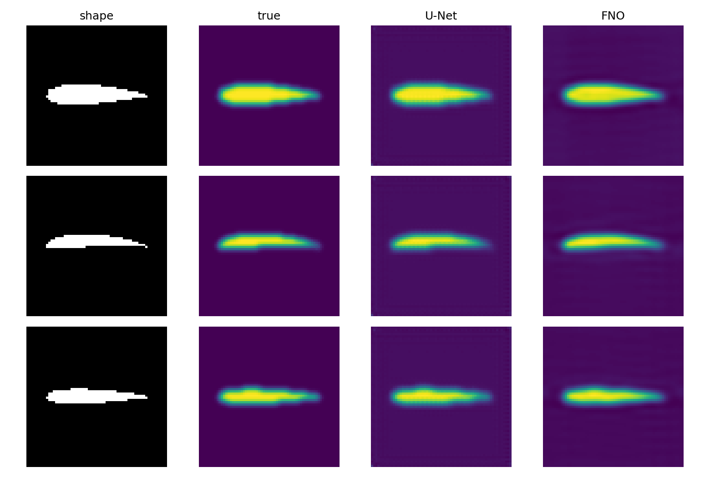

# Navier-Stokes Flow Predictor

 

A neural surrogate that predicts 2D airflow around airfoils from an image of the shape, trained on the [AirfRANS](https://airfrans.readthedocs.io) benchmark (RANS solutions of the Navier-Stokes equations).

Instead of solving the equations numerically for every new shape, the model learns the mapping from shape to flow field and predicts it in milliseconds. A CFD solver provides the ground truth to compare against.

## Planned outputs

1. **Flow field:** pressure and velocity around the airfoil

2. **Shape parameters:** NACA camber, camber position and thickness read from the image

3. **Equation:** the NACA formula built from the predicted parameters

## Status

- [x] Training and evaluation pipeline (tested on synthetic data)

- [ ] Real AirfRANS data loader

- [ ] U-Net baseline trained on AirfRANS

- [ ] Comparison with a Fourier Neural Operator

- [ ] Shape-parameter and equation output

- [ ] Speed-up vs. CFD solver

- [ ] Generalization to unseen shapes and flow conditions

- [ ] Demo app

## Setup

Install the requirements:

    pip install -r requirements.txt

Download and convert the data (needs the airfrans package):

    python src/download.py
    python src/convert.py

Train and evaluate:

    python src/train.py --epochs 50
    python src/evaluate.py

## Results

| Model | Pressure error | Velocity error | Time per sample |
|-------|----------------|----------------|-----------------|
| U-Net | to be added | to be added | to be added |
| FNO | to be added | to be added | to be added |

Real results will be added after training on AirfRANS.

The figure below comes from **synthetic placeholder data** and only shows that the pipeline runs. It is not a real result.

